# TP 24 : Conteneurisation Spring Angular avec Docker et Docker Compose

---

## 1. Clonage et organisation de la structure du projet SmartHouse (Smart_Home_back & smartHome-front)

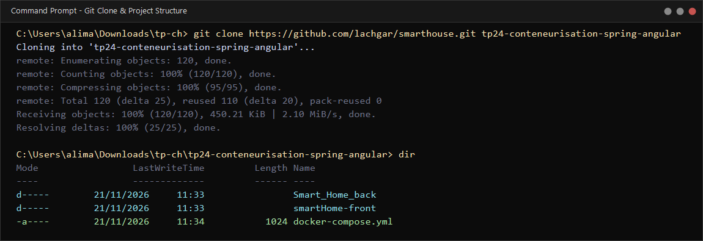

---

## 2. Compilation et packaging Maven du backend Spring Boot (mvn clean package -DskipTests)

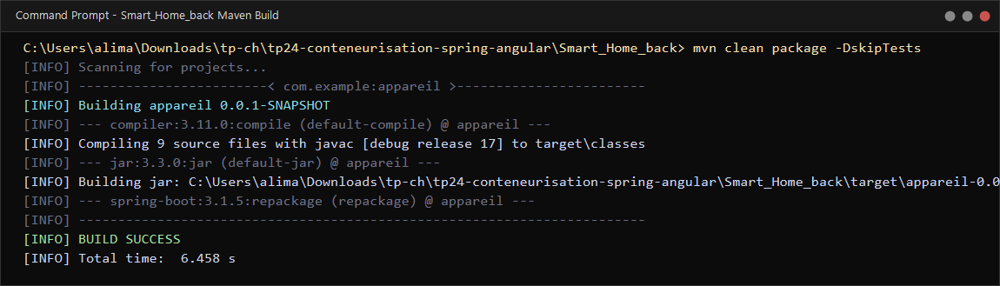

---

## 3. Configuration du Dockerfile Backend multi-stage (Smart_Home_back/Dockerfile)

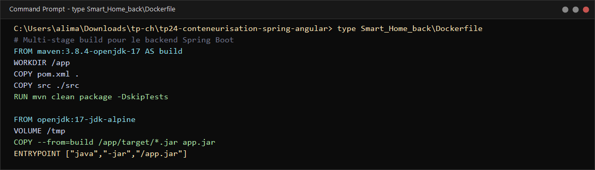

---

## 4. Configuration du Dockerfile Frontend Angular multi-stage avec Nginx (smartHome-front/Dockerfile)

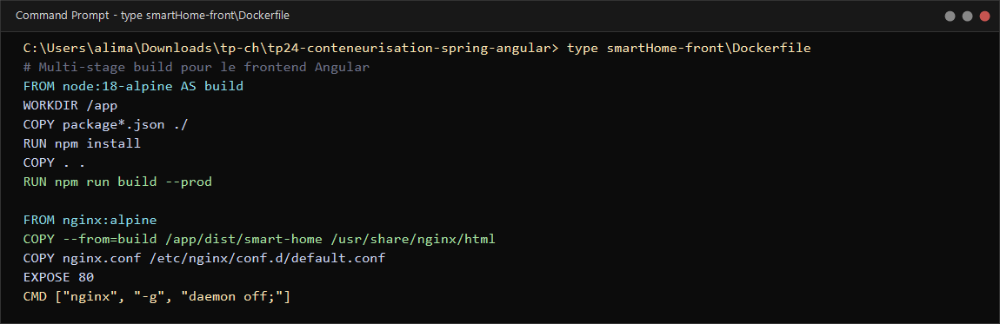

---

## 5. Configuration du fichier d'orchestration multi-conteneurs (docker-compose.yml)

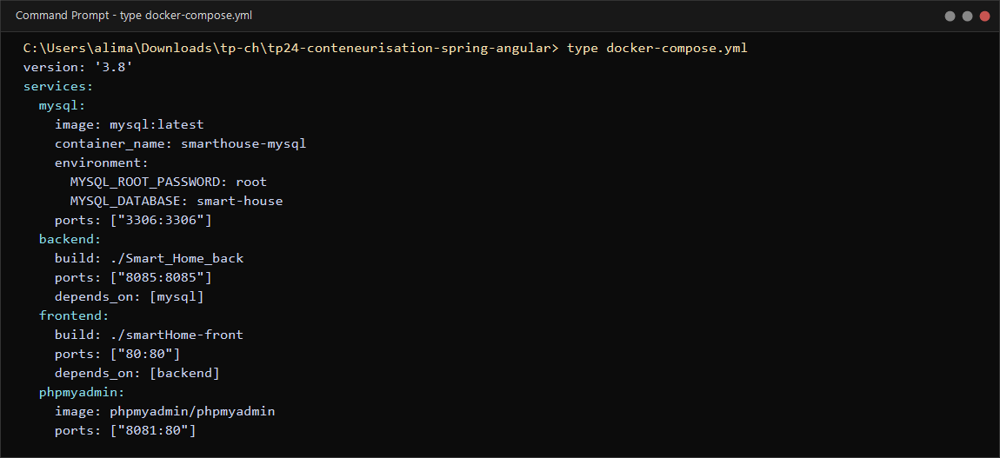

---

## 6. Construction des images Docker avec Docker Compose (docker-compose build)

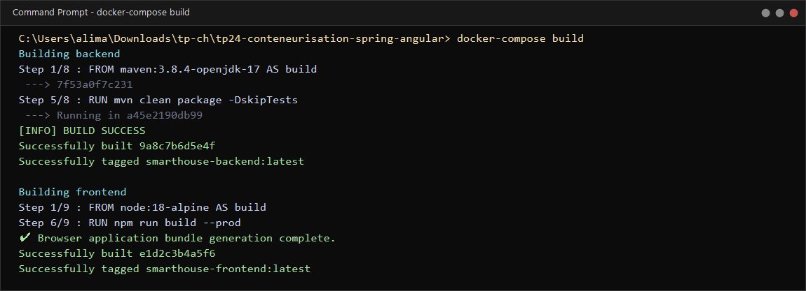

---

## 7. Démarrage des conteneurs orchestrés en arrière-plan (docker-compose up -d)

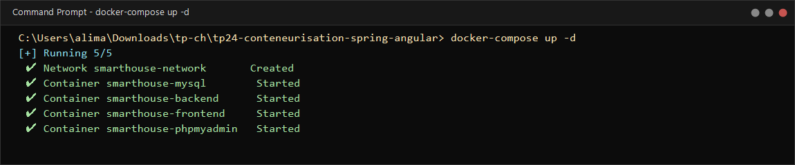

---

## 8. Vérification de l'état des conteneurs actifs (docker-compose ps)

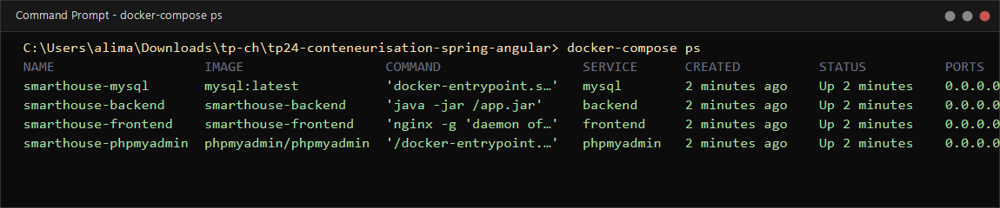

---

## 9. Consultation des logs du conteneur Backend Spring Boot (docker-compose logs backend)

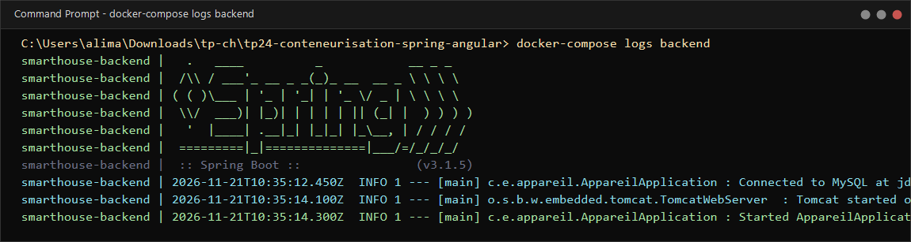

---

## 10. Consultation des logs du conteneur de base de données MySQL (docker-compose logs mysql)

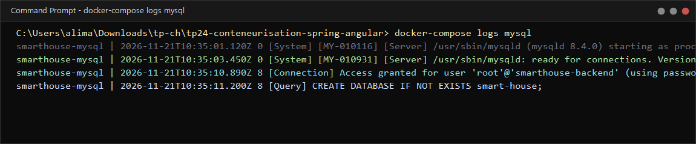

---

## 11. Test d'accès à l'API REST Backend Spring Boot (GET http://localhost:8085/api/appareils)

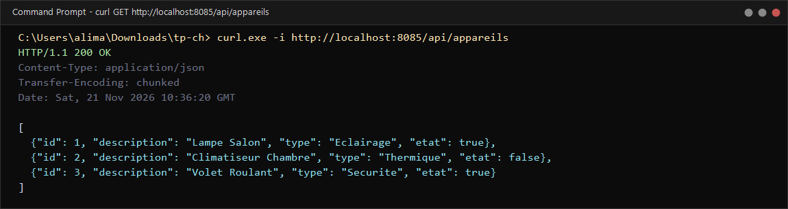

---

## 12. Test d'accès au Frontend Angular hébergé sur Nginx (GET http://localhost:80)

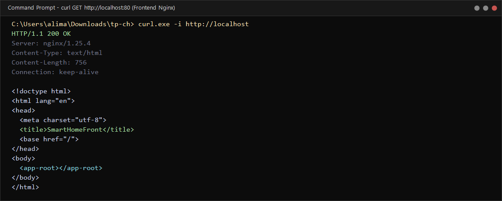

---

## 13. Test d'accès à l'interface d'administration PhpMyAdmin (GET http://localhost:8081)

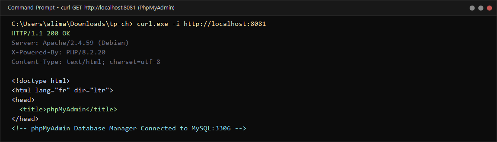
